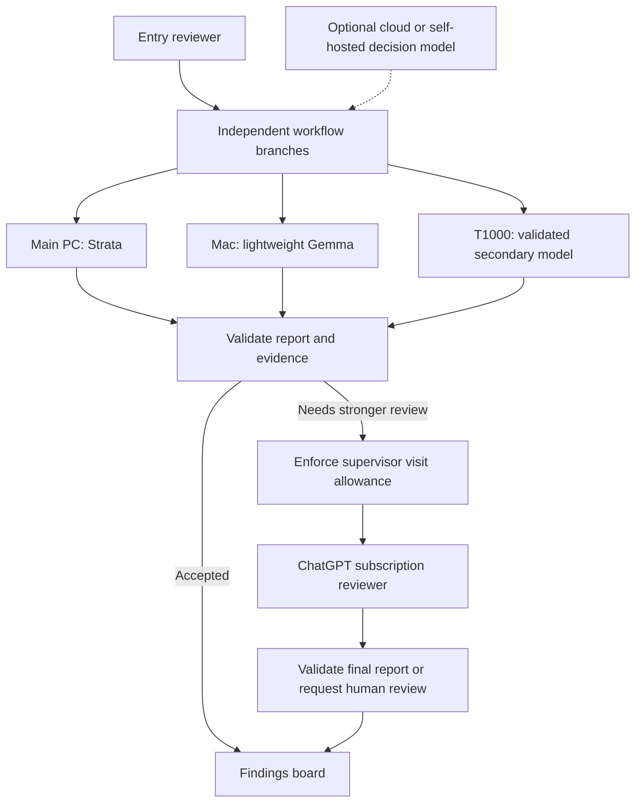

# Crawlspace production readiness

Reviewed and remediated 10 October 2026 against the current working tree, including BYOM, Code Mode, subscription authentication, bounded parallel workers, native decision routing and reliability changes.

## Verdict

**Ready for real-endpoint commissioning and a supervised local pilot. Unattended operation on the proposed hardware and subscription remains unverified.**

One Crawlspace controller can call separate local or LAN inference endpoints and run independent review branches concurrently. Each person configures endpoints and credentials in their own local copy. Pi and Code Mode are installed and integrated. The application gaps identified below have received bounded escalation, supported subscription sign-in, retries, context controls, recovery fixes and parallel scheduling. No real Strata/Bonsai/Gemma endpoint or OpenAI account has been exercised.

This is an engineering readiness review and implementation follow-up, not a completed penetration test or certification of external model servers. The historical findings are retained below; the following table describes the current implementation.

## Knowledge follow-up, 11 October 2026

The separate **Knowledge** page prepares text, PDF pages, images, audio clips and video/audio chunks locally, then explicitly indexes them using Gemini, Vertex or a compatible text embedding endpoint. Cloud indexing and query embedding each require action-specific consent. Saved vectors are normalized, search preserves source locations, and media chunks remain downloadable. Storage is bounded and validated, sources publish only after every chunk succeeds, and cancellation/shutdown drain active work. See [setup, limits and commissioning](KNOWLEDGE-SETUP.md).

Provider and account access, retrieval quality and throughput still require commissioning against the intended machines or Google project. Current checks use local media tools and fixture embedding transports. Dense PDF pages can exceed Gemini's input window despite page splitting. Workflow review agents do not yet retrieve from this library automatically, and knowledge requests do not share workflow endpoint slots; avoid overlapping heavy requests on a constrained host.

After this follow-up, **199/199 backend tests passed with no skips**, the production build passed, and both the existing workflow and Knowledge browser checks passed. The Knowledge check includes a complete UI-to-API-to-compatible-provider flow using a loopback fixture, durable vectors, search, chunk downloads and exports. PDF worker deadline/cancellation, actual FFmpeg conversion and Windows link rejection are exercised locally; Google/Vertex inference and real local embedding quality remain untested. The build retains its advisory warning about the main frontend bundle exceeding 500 kB.

## Tool reliability follow-up, 12 October 2026

The **Tool reliability** page records real Pi worker and supervisor visits by model entry, endpoint, effective account and execution settings. Direct and nested tools share ordinary-tool totals, with separate Code Mode wrapper results. Invalid arguments and unknown tools remain distinct from executed-tool errors, script errors, output limits, policy blocks and cancellation. Retries, provider failures, rejected reports and repair attempts remain visible even when the visit ultimately succeeds. Tool-budget cancellation is excluded from provider-error counts.

The separate local history retains the latest 1,000 drained visits, validates its metadata, serializes atomic writes and recovers a last-good backup. It stores counts, settings, outcomes and timings without arguments, code, results, source text or raw errors. Failed writes preserve in-memory observations and surface a storage warning without failing the agent. Corrupt primary and backup history disable recording visibly instead of overwriting evidence. An abrupt process termination can lose in-flight observations; demo runs, probes and classifier requests are excluded.

This is passive workload evidence. It does not change JEV routing or supervisor allowances, and different assignments and small samples prevent treating success percentages as a controlled model-quality benchmark. Real Strata, Maya and cloud-model reliability still need measurement on the intended deployment. See [usage and comparison semantics](README.md#tool-reliability).

The full backend suite passed **220/220 tests with no skips** at the integration checkpoint. The final focused Pi tracker suite passed **10/10 cases**, including three additional faults covering partial-tool retries, unhandled script errors and policy-block attribution. The existing Pi smoke also passed real Code Mode loops, shared tool limits, CPU and stream cancellation, screenshots and bounded retries. The production build and existing workflow browser smoke passed; the build retains its advisory warning about the frontend bundle exceeding 500 kB.

The focused reliability browser check passed empty/error/stale states, failure categories, configuration filters, exact rate denominators, refresh/poll cleanup and mobile layout. Its unmocked phase verifies the actual tracker-to-durable-store-to-API-to-dashboard path and confirms private tool inputs/results are absent from saved history. Desktop and mobile screenshots were visually inspected. These checks use local fixtures and do not call the intended models.

## Authentication and hosting integration, 12 October 2026

The remote authentication/hosting implementation is integrated with local models, Code Mode, decision routing, knowledge indexes, reliability tracking and the refreshed UI. Accounts have private workspaces and cookie/CSRF protection, including binary knowledge uploads. The first account inherits legacy workflow, screenshot, knowledge, reliability and ChatGPT association data without deleting the originals. Local copies retain operator-controlled endpoint/key allowlists and private project roots; approve the intended LAN inference origins before connecting them. Hosted browser sign-in cannot initiate the loopback ChatGPT flow.

Comparison candidates receive independent snapshots before endpoint queuing, and judges receive every current-cycle predecessor output. Supervisor review carries the primary evidence and a bounded draft while retaining independent inputs. Judge preflight rejects insufficient/circular candidates before inference. Workflow and endpoint limits, bounded output history, cancellation/draining, retries and tool-call telemetry remain active. Legacy workflow cycles stay bounded and sequential within their cycle component.

Validation passed: **265/265 backend tests with no skips**, typecheck, production frontend/server build, actual-Pi/Code Mode smoke, mocked subscription and parallel smokes, and authenticated workflow, UX, Knowledge and reliability browser checks. A focused auth browser regression verifies that delayed responses from revoked sessions cannot sign out a newer account or clear its cookie. The compiled-server smoke also verifies the separate PDF worker, binary-upload CSRF, hosted headers/cookies, login/logout and session persistence after restart. The Docker recipe includes FFmpeg for audio/video preparation; the native host must install it separately. Docker/Ubuntu deployment itself was not executed here. The main bundle advisory remains (about 615 kB minified, 188 kB compressed).

These checks use loopback or mock inference and isolated test accounts. The real machines, real model quality, subscription eligibility, public hosting and sustained-use release gates in this document remain unverified.

## Acceptance workflow follow-up, 12 October 2026

Model-free report checks and acceptance gates now supplement the existing agent graph. Checks validate configured output, finding evidence, comparison judgment and severity requirements. Gates preserve accepted workers, return only missing requirements for at most three corrections, and hold downstream work until acceptance. Severity blocks are terminal; rewriting a report is not a way to resolve a reported issue. Corrections retain the worker's original independent context and share existing endpoint, routing and supervisor limits.

High-impact gates require human approval. Approval requests identify the exact run, gate, cycle and request timestamp, preventing an old browser view from approving a later cycle. Final worker reports and check evidence are snapshotted independently of the 200-result history limit. Checked-report screenshot leases protect evidence while sibling branches finish, and pending approval snapshots remain protected against pruning. Stop and restart close pending approvals without releasing downstream work. Authentication, account isolation and CSRF apply to approval mutations.

Runs retain up to 500 unit outcomes separately from tool-call telemetry. Curated lessons are manually managed, scoped to existing agents and included only when enabled in matching Pi briefs. No failure automatically becomes a persistent instruction. Existing all-agent workflows keep their previous scheduling behavior; acceptance workflows require explicit feedback edges and exclusive correction ownership so downstream results cannot become stale.

Validation: the full backend suite passed **299/299 cases with no skips**, followed by the final targeted pre-approval screenshot lease regression. The production build, existing workflow and UX browser checks, new gate browser smoke, actual Pi/Code Mode smoke (including scoped lessons and correction briefs), and compiled-server startup/restart checks passed. A large-run regression produces 251 results and verifies the frozen approval bundle preserves all 64 final worker/check reports after ordinary history trims to 200. The frontend bundle advisory remains (about 635 kB minified, 193 kB compressed).

These are report acceptance controls for the existing read-only tools. They do not execute tests, edit projects, deploy changes, certify model judgments or implement dynamic graph planning. One human gate per workflow is supported, with automatic gates available at earlier stages. Actual model quality, hardware commissioning and sustained unattended operation remain unverified.

## Local project implementation follow-up, 13 October 2026

Project settings are now saved separately from workflow configuration and supply every agent's folder and preview URL. An explicit local selection can use an existing folder outside the private account directory. Canonical validation rejects filesystem roots, Crawlspace's account/configuration data and reserved project roots; hosted accounts retain their private project confinement and read-only execution. Selection and permission changes require an idle workspace and authenticated CSRF-protected requests.

Local agents can opt into focused file editing and named test execution after the matching project permissions are enabled. Existing-file edits require a successful read, an unchanged observed hash and a unique exact-text match. File creation commits without overwriting an existing destination. Traversal, links/hard links, secret/generated paths, invalid UTF-8 and oversized sources are blocked. Code Mode exposes the same enabled custom tools; built-in arbitrary shell/edit tools remain disabled. Test subprocesses receive a limited environment, bounded/redacted output, timeouts and process-tree cancellation. Configured commands run trusted project code with the OS user's permissions; this is not an OS sandbox and hosted command execution is disabled.

Mutating workflows serialize visits, and a controller-wide canonical-folder lease prevents another account's reader or writer overlapping them. Read-only workflows retain parallel scheduling. Actual command receipts and changes enter run/approval evidence; completed activities remain in messages if a visit subsequently fails or stops. A passing-test gate requires every configured command after the latest agent edit, including edits from another worker. Provider-supplied test metadata is ignored. Edits take effect directly; stopping or rejecting a gate does not roll them back. External edits outside Crawlspace and separate controller processes are not coordinated by the in-process revision/lease mechanism.

Validation passed: **338/338 backend tests with no skips**, including real Windows subprocess exit/timeout/Stop/descendant cleanup and installed Pi direct/Code Mode edit/create/test flows. Project browser checks verify folder selection, permission persistence, command setup, implementation preset, execution evidence and 320/390-pixel layouts. Existing workflow and UX browser checks passed. The production build passed with the existing bundle-size advisory; real OpenAI/local model behavior with the new tools still needs user commissioning.

## Implementation follow-up

| Original gap | Current outcome | Remaining deployment check |
| --- | --- | --- |
| Subscription authentication | Sign in with ChatGPT, saved profiles, explicit plan consent, verified OIDC identity, protected credentials, serialized rotating refresh and revocation. Scoped public Responses adaptation preserves Pi tools and Code Mode; incomplete or late-failed responses are rejected. | Sign in with the actual account; confirm eligibility, model access, revocation and exhausted-plan behavior. |
| Conditional escalation | Optional supervisor receives a typed reason or an eligible exhausted local failure. Configuration/auth errors and Stop do not escalate. Defaults are one supervisor visit per cycle and ten per run; failed visits consume allowance, and recursion is blocked. Valid primary evidence is retained even when escalation fails or hits a cap. | Evaluate when the selected local models request stronger review and measure quality/usage. These are visit limits, not exact request/token/spend quotas. |
| Provider/report failures | At most three transient attempts, bounded cancellation-aware Retry-After handling, and one report repair shared across the visit. Tools share the original 40-call allowance across attempts. Remaining failures stop visibly; a new run starts a fresh traversal. | Repeat fault injection against the actual inference runners and LAN. |
| Context and execution budgets | Model-specific output, reasoning and full-visit timeout controls. Conservative request budgeting includes schemas, history, tools and images; mandatory instructions remain intact. Responses reasoning/tool history stays intact or fails clearly when full. Subscription output limits reserve context locally because that transport does not accept an output-token cap. | Configure each runner's actual context and measure memory, reasoning behavior and task duration. Token estimates are conservative, not a tokenizer-derived effective-context measurement. |
| Stop/restart and edits | Lifecycle and configuration changes serialize; Stop cancels queued visits and drains every active worker before unlocking. The first terminal branch failure cancels siblings and preserves already committed evidence. Server shutdown rejects incoming work, cancels probes, and drains model sessions and credential writes. | Test process termination/restart and offline-host cancellation with concurrent inference in the deployment. |
| Durable state | Synced atomic replacement, publish-after-save, validation of saved state, last-good backup recovery, and honest locking if even failure-state persistence fails. | Low-disk and abrupt-restart soak on the actual filesystem; backups can lose the latest update. |
| Endpoint readiness | Explicit user-requested streaming/native-tool/JSON probe uses the selected model's reasoning/output settings and isolated tools. No connection is implied by configuration readiness alone. | Test real Code Mode and image input separately. The configured model identity/context still need confirming at the runner. |
| Findings and screenshots | Recurrence refreshes evidence and reopens resolved findings. Serialized screenshot prune/write/reference publication bounds parallel captures to 200 files / 256 MiB by default; unreferenced captures expire after seven days. Pending leases protect concurrent captures through report commit/discard. Referenced evidence is preserved, so a full allowance blocks further captures. | Confirm evidence quality and storage behavior during sustained use. Resolving a finding alone does not release its screenshot. |
| Runtime packaging and traces | `tsx` is a production dependency; an isolated production-only install started successfully and served the frontend and Pi health. Completed reports log attempts, requests, duration, model and reported tokens; escalation reasons are recorded. | Measure cold starts and performance. Failed visits have errors/routing records but no complete token/duration trace. |
| Parallel scheduling | Opt-in global limit of 1–8 actual visits, default 1. Independent branches overlap, joins wait for committed prerequisites, and directed cyclic components serialize. Each enabled endpoint pool uses the strictest configured alias limit, default 1; primary and supervisor visits share those pools and the global cap. Queued busy-endpoint visits do not block another machine. Context is snapshotted when the visit starts; each SDK attempt has isolated runtime files. | Start with three global slots and one per endpoint on the proposed machines. Measure overlap, latency, memory and cancellation against the actual runners before raising limits. |
| Native Jev routing | Optional off/shadow/active routing uses Pi's native System One or llama.cpp classifier adapter. Cloud and self-hosted decision endpoints are configurable. Fixed worker/supervisor/review choices, strict probability validation, durable records, deadlines and decision allowances precede worker execution. Classifier visits share endpoint/global capacity; supervisor choices consume existing supervisor allowances. | Configure a real decision endpoint and evaluate shadow records against labeled tasks before enabling active routing. Local chat probabilities are not validated Jev calibration. See [setup](JEV-SETUP.md). |

## Proposed machines

| Machine | Intended role | Assessment |
| --- | --- | --- |
| Main Windows PC: RTX 5060 Ti 16 GB; planned 64 GB DDR4 | Controller and primary Strata/Qwen3.8-Flash-Next worker | Fits Strata's documented hardware class after the RAM upgrade. Start with its recommended IQ2_XS selection and measure before choosing larger variants. |
| Windows PC: T1000 8 GB; 16 GB DDR4 | Secondary worker or optional decision model | Below Strata's normal Flash-Next requirements. Bonsai 2 PTQ1_0 is a credible constrained trial; exact Windows/T1000 compatibility and performance are unverified. |
| Mac Mini M4: 16 GB unified memory | Lightweight classification, extraction, or second review | A quantized 4B Gemma variant is plausible. The exact model and quantization still need selecting and testing. |
| OpenAI subscription | Strong reviewer for selected difficult cases | Supported sign-in and bounded escalation are implemented and mock-tested. The user's plan and real inference entitlement remain unverified. |

The local GPU query confirmed an RTX 5060 Ti with about 16 GB VRAM. The other specifications and planned RAM upgrade are user supplied, not remotely measured.

Strata documents RTX 20-50 GPUs with at least 12 GB VRAM, at least 32 GB RAM, and about 80 GB free disk. Its 64 GB recommendation is IQ2_XS. Published results on other GPUs are not measurements of this machine. [Strata requirements and model choices](https://github.com/Niko1221/Strata#what-you-need)

Qwen labels Flash-Next an experimental architecture preview. Hardware fit therefore needs to be followed by workload-specific quality and reliability testing. [Official Qwen model card](https://huggingface.co/Qwen/Qwen3.8-Flash-Next)

Bonsai's PTQ1_0 language weights are 5.95 GB; cache, buffers and optional vision require additional memory. Use the vendor's compatible runner. Its documented Linux RTX 2080 8 GB trial supports trying a small context and one slot, but does not validate the Windows T1000. [Bonsai model card](https://huggingface.co/prism-ml/Ternary-Bonsai-2-27B-gguf), [8 GB hardware notes](https://github.com/PrismML-Eng/Bonsai-demo/blob/main/AGENTS.md#linux-cuda-setup-notes-rtx-2080-8-gb)

If the Mac model means Gemma 4 E4B, Google's Q4_0 static loading estimate is about 4.5 GB, before runtime/context costs. This supports a trial rather than proving the selected workload fits. [Google model and memory documentation](https://ai.google.dev/gemma/docs/core)

## Architecture that fits this deployment

Keep one controller on the main PC. Project reads, browser captures, workflow state and Code Mode execution stay there. The other machines serve inference over a private network. This does not pool their RAM or GPUs into one model.

For the proposed three machines, configure **Maximum parallel agents = 3** and **Endpoint request slots = 1** for each model. Branch after the entry agent into independent review assignments, then join at a coordinator that needs their combined evidence. The default straight-chain workflow remains sequential even with a higher global limit. `maxParallelAgents` and `maxConcurrentRequests` both accept 1–8 and default to 1, preserving existing workflows unless concurrency is explicitly enabled.

In parallel mode, each join waits for all predecessor reports to commit. Explicit loop connections and connections returning to the entry agent do not add within-cycle dependencies. Other directed cycles become components whose nodes run serially in traversal order; their children wait for the entire component. The next cycle waits for all branches to drain. Legacy single-worker mode preserves its breadth-first order.

Endpoint capacity is grouped by normalized URL origin, including default provider URLs, different model/path aliases and equivalent loopback hosts. The lowest limit among enabled aliases wins. Primary and supervisor visits share the endpoint and global actual-visit limits; escalation releases the primary slot before queuing the supervisor. Supervisor allowances are reserved through serialized durable state updates, so simultaneous requests cannot overspend them. A reserved allowance can be consumed even if sibling cancellation prevents that supervisor from starting.

Each actual visit reads the latest committed context after acquiring capacity; running siblings keep separate snapshots. SDK runtime/auth/catalog files are isolated per attempt and cleaned after the session drains. Pending screenshot leases bridge capture publication and report commit/discard. Endpoint-queue waiting is cancellable but outside the executor's full-visit timeout, so queue delay must be measured separately from inference duration.

Remote endpoint URLs are already accepted by [validation.ts](C:/git/ai-crawler/server/validation.ts:39) and used by [pi.ts](C:/git/ai-crawler/server/pi.ts:33). Keep the controller's existing loopback binding. Remote inference does not require publishing the Crawlspace API to the LAN.

For Strata, use Crawlspace's **custom** provider with the OpenAI-compatible `/v1` endpoint. The current `openai` provider selects Responses instead of Chat Completions. Strata documents streaming and native tool calls; real-model Code Mode and final-report compliance still need testing. [Strata API documentation](https://github.com/Niko1221/Strata/blob/main/docs/DETAILS.md)

Protect remote inference with authentication and a private/encrypted connection as appropriate; loopback on a remote machine is not reachable from the controller. Strata documents LAN binding and API keys. [Strata security policy](https://github.com/Niko1221/Strata/blob/main/SECURITY.md)

Crawlspace currently reviews source and screenshots using read-only tools. It does not distribute filesystem access or run automated edits/tests on the worker machines.

## Initial findings, before remediation

This table records the original review evidence and required outcomes before the implementation follow-up above. Its descriptions of missing application features are historical. External deployment checks remain open.

| Priority | Finding and evidence | Required outcome |
| --- | --- | --- |
| P1 | **Subscription access is missing.** Configuration only has environment-key credentials, and Pi models are registered under synthetic provider IDs. There is no sign-in, account selection, refresh or revocation flow. [types.ts](C:/git/ai-crawler/shared/types.ts:14), [pi.ts](C:/git/ai-crawler/server/pi.ts:30) | Dedicated supported subscription integration, protected credential storage, refresh/revocation handling and a completed inference entitlement check. |
| P1 | **No conditional escalation or fallback.** Each reachable graph node runs with its assigned model. Assignments are messages, not scheduling decisions. [engine.ts](C:/git/ai-crawler/server/engine.ts:139), [engine.ts](C:/git/ai-crawler/server/engine.ts:211) | Typed routing outcomes, explicit reasons, a bounded fallback policy and a limit on stronger-model calls. |
| P1 | **A transient failure stops the whole loop.** Pi retries are disabled; provider failures and malformed/truncated final JSON fail the run. [pi.ts](C:/git/ai-crawler/server/pi.ts:69), [engine.ts](C:/git/ai-crawler/server/engine.ts:184) | Bounded transient retries, cancellation-aware backoff, one bounded report repair attempt, and a defined failed-step/resume policy. |
| P1 | **Context and generation budgets are not fitted to the model.** Forty messages and fifty findings are selected by count, not tokens; compaction is off. Output is capped at 8,192 tokens and the visit timer is fixed at three minutes after session creation. [pi.ts](C:/git/ai-crawler/server/pi.ts:36), [pi.ts](C:/git/ai-crawler/server/pi.ts:154), [pi.ts](C:/git/ai-crawler/server/pi.ts:170) | Reserve output space, budget all prompt/tool content, and expose model-specific output, reasoning and timeout controls. Include startup/queueing in deadline handling. |
| P1 | **Stop permits a restart before cleanup drains.** `active` is cleared immediately after abort. Late reports are guarded, but a new session/model edit can overlap the old executor's cleanup and shared Pi files. [engine.ts](C:/git/ai-crawler/server/engine.ts:102) | A stopping state and serialized lifecycle; a new run starts only after prior work drains. |
| P1 | **A failed save still changes live state.** Memory is updated before file write/rename succeeds. A disk error can leave the UI showing unpersisted state. Reload validation is shallow and no last-good snapshot is kept. [store.ts](C:/git/ai-crawler/server/store.ts:55) | Serialize mutation and durable commit, publish after success, and support validated recovery from the last good state. |
| P2 | **Readiness does not contact the server.** Health checks confirm configuration and SDK availability only. [index.ts](C:/git/ai-crawler/server/index.ts:35) | An explicit connection/capability probe, actual model identity/context, and useful offline/overloaded/cold-start status. |
| P2 | **Continuous runs can leave stale findings and grow screenshot storage.** Repeated node/title/file findings are discarded, so updated evidence or recurrence after resolution is lost. Captures have no retention policy. [engine.ts](C:/git/ai-crawler/server/engine.ts:208), [pi.ts](C:/git/ai-crawler/server/pi.ts:132) | Update/reopen recurring findings and bound screenshot storage while retaining referenced evidence. |
| P2 | **Multiple model servers take turns.** Visits are sequential; Code Mode parallelizes tool calls within a visit. There are no per-endpoint queues or model usage/timing/routing records. [engine.ts](C:/git/ai-crawler/server/engine.ts:155) | Sequential operation is acceptable initially. For simultaneous workers, add bounded concurrency for independent work, plus endpoint limits and traceable decisions. |
| P2 | **Production-only installation cannot run the current start command.** `start` requires `tsx`, which is a dev dependency; the build emits the frontend but does not compile the server. [package.json](C:/git/ai-crawler/package.json:9) | Compile/package the server or declare its runtime dependency correctly, then verify a clean production install and startup. |

Reasoning controls are now configurable and forwarded, but their effect depends on the runner. Server-side defaults can still consume the output budget. Measure the actual response and reasoning behavior for each selected model.

## OpenAI subscription path

Current official documentation supports eligible Plus/Pro users authorizing plan usage in open-source/local apps through **Sign in with ChatGPT**. This consumes applicable plan limits; it is not extra unlimited allowance. API-key usage remains a separate billing path. [Local app integration](https://developers.openai.com/siwc/token-sharing-open-source), [user permissions and limits](https://learn.chatgpt.com/docs/sign-in-with-chatgpt)

The new dedicated connection service supplies stable registration, verified identity, account/session management and refresh/revocation; the Pi transport supplies subscription request adaptation. Credentials are stored outside the project, protected by current-user DPAPI on Windows and owner-only permissions on Unix. Existing Codex credentials and client IDs are not reused. [Registration](https://developers.openai.com/siwc/token-sharing-open-source/sign-in), [sessions](https://developers.openai.com/siwc/token-sharing-open-source/profiles-and-sessions)

The implemented dedicated transport retains the existing Pi/Code Mode workflow. Verify real model access through a completed authenticated request, not a static model list. Subscription requests use streaming, full input and no stored response; local functions and Code Mode use the supported additional-tools representation. [Request limitations](https://developers.openai.com/siwc/token-sharing-open-source/preview-limitations), [model access verification](https://developers.openai.com/siwc/token-sharing-open-source/models-and-inference)

## JEV-style decisions

Jev is a typed decision model rather than a text/code generator. Its structure suits a bounded router: choose the worker, decide whether stronger review is needed, and identify cases requiring human input. [TypeSafe coding-agent guide](https://docs.typesafe.ai/introduction/coding-agents)

Keep scheduling and usage limits in controller code. Let an optional classifier provide a typed decision, then enforce allowed destinations and attempt limits. Evaluate confidence thresholds on representative tasks: a concentrated answer distribution is not proof the answer is correct. Include an explicit unknown/needs-review outcome. [Confidence semantics](https://docs.typesafe.ai/confidence)

Crawlspace now has optional native classifier configuration and a routing hook before local review visits. Its Code Mode model bridge remains disabled with `models: false`; routing runs in the controller and preserves graph dependencies, endpoint capacity, supervisor allowances and confined tools. This initial router selects the assigned worker or configured supervisor; it does not select arbitrary agents or declare the whole workflow finished. [Setup and evaluation](JEV-SETUP.md)

Hosted Jev requires its own TypeSafe access and sends bounded assignment metadata and selected retained review text to that service. A self-hosted native decision model can use the same System One protocol. Pi's local chat classifier uses llama.cpp's tokenization, template and next-token probability endpoints; ordinary OpenAI-compatible chat support alone is insufficient. Its probabilities need workload evaluation rather than an assumption of Jev calibration. [TypeSafe API](https://docs.typesafe.ai/api), [Pi local classifier implementation](https://github.com/earendil-works/pi/blob/main/packages/ai/src/api/llama-cpp-classify.ts)

## Validation and release gates

After the decision-routing follow-up, the production build, **130/130 backend tests (no skips)** and expanded UI smoke passed. The earlier actual Pi SDK / Code Mode and mocked subscription transport checks also passed. Coverage includes dependency planning, global/endpoint capacity, busy-endpoint queue bypass, committed join context, cycle barriers, sibling cancellation/draining, supervisor sharing and atomic allowances. The reliability checks also cover shared retry/tool limits, CPU-loop and stream cancellation, screenshots, malformed reports, transient failures, quota exhaustion, context fitting, save failures/recovery and lifecycle/configuration ordering. Authentication tests use mocked remote responses, a real loopback callback and actual Windows DPAPI in temporary fixtures; no real credentials or plan usage were involved. Shutdown regressions cover slow request bodies, repeated shutdown and cleanup after a failed stop-state save.

The `npm run test:parallel` check passed with the installed Pi SDK and native decision adapter: a self-hosted System One fixture routed four actual Pi visits, two loopback worker endpoints overlapped, runtime directories/catalogs were separate, Code Mode loops kept their own visit stores, and the join received both durably committed findings and messages. A second run stopped and drained both streaming visits within five seconds, removed their temporary runtime files, and published no cancelled findings. API admission regressions also passed for probes racing run startup.

Native classifier tests cover hosted and self-hosted System One, llama.cpp token probabilities, model-version capture, strict distributions, bounded metadata, redirects/body limits, no hidden retries, deadline/Stop cancellation and asynchronous stream cleanup. Engine checks cover shadow preservation, threshold policy, atomic decision/supervisor allowances, durable reservations/outcomes, failed saves and no late workers. The browser smoke covers hosted/local settings, draft probes, terminal statuses, 500-record exports and mobile layout. These fixtures validate the integration and policy, not classifier calibration or real cost savings.

A clean offline install with only production dependencies started outside the repository, reported Pi available, and served the built frontend and its assets. The original review's production dependency audit reported **zero known advisories**. No Strata/Bonsai/Gemma endpoint, LAN workload or subscription inference was exercised, and no 24-hour soak was run.

Before calling this deployment production ready:

1. Probe each real endpoint for streaming, native tool calls, Code Mode, valid final reports, cancellation and its effective context. Test image input separately for every screenshot-capable model.
2. Measure cold start, first-token latency, queue delay, full-step duration and peak RAM/VRAM at the selected quantization/context. Start with one visit per endpoint and three global slots; confirm actual overlap on independent branches and keep validated models warm where appropriate.
3. Repeat offline-host, server-restart, timeout, 429/503 and truncated-JSON failures against the actual runners while other branches are active. Confirm bounded retries, cancellation/drain behavior, correct fallback and no runaway cloud visits.
4. Complete subscription sign-in, refresh, revoked-session and exhausted-plan checks using the user's actual plan.
5. Run a 24-hour representative soak, including controller restart and low-disk conditions. Require bounded storage, honest run status, traceable decisions and successful recovery.
6. Evaluate a representative labeled shadow dataset for the selected decision-model and question versions before enabling active routing. Measure local classifier temperature, confidence bands, review quality and total model usage.

Application reliability, context budgeting, supported subscription authentication, bounded escalation, parallel workers and optional decision routing are implemented. The deployment release gates remain real endpoint/account commissioning, classifier shadow evaluation and sustained-use evidence.

## UX follow-up, 12 October 2026

The workspace now groups navigation into Workspace, Resources and Insights. Node templates have purpose-based shelves, and the model library separates local and cloud connections with search and filters. Forms, cards and status labels use a consistent readable scale and darker text. Knowledge presents preparation, chunk review and search in order; findings expose result counts and filter reset; assignments require an agent recipient.

Phones use labeled navigation and agent-settings drawers. Keyboard checks cover Enter/Space on graph nodes, trapped dialog focus, Escape, focus return, background scroll locks and protection against deleting graph nodes behind drawers. The mobile template preview keeps both Back and Add available while details scroll. Workflow fields, graph editing and destructive agent controls lock during an active run while the library remains available for browsing. Unsaved workflow changes trigger the browser's leave-page prompt.

Validation: production build and UI, UX, Knowledge and Tool reliability browser suites passed. The UX suite checks all eight screens at 320, 390, 768, 1280 and 1512 pixels without horizontal page overflow, including long content, filters, active-run controls and adding a new agent. Screenshots are saved under `.crawlspace/previews/ux-*.png`. Knowledge and reliability checks also exercise actual local API/store flows with loopback fixtures. These checks made no real model or cloud requests.

The build retains its existing bundle-size advisory (about 580 kB of minified JavaScript, 177 kB compressed). This sweep is not a formal accessibility certification or validation of the real model deployment; the endpoint, account and sustained-use release gates above still apply.
